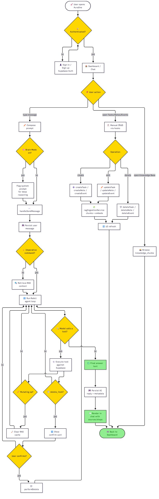
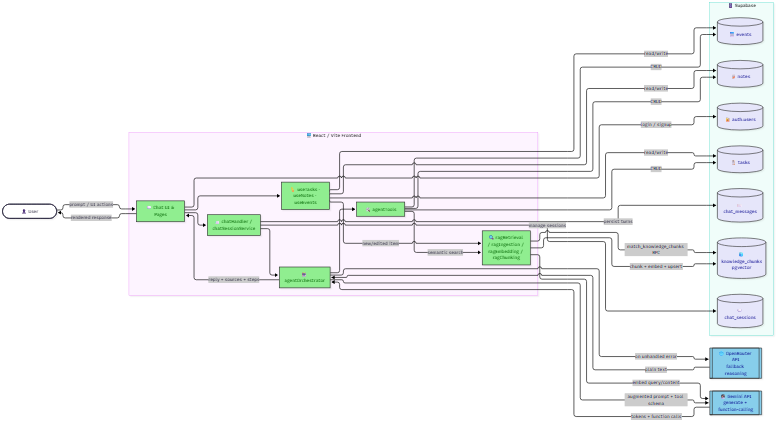
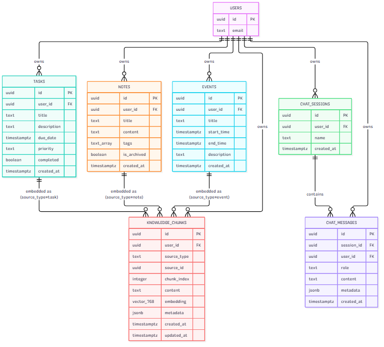
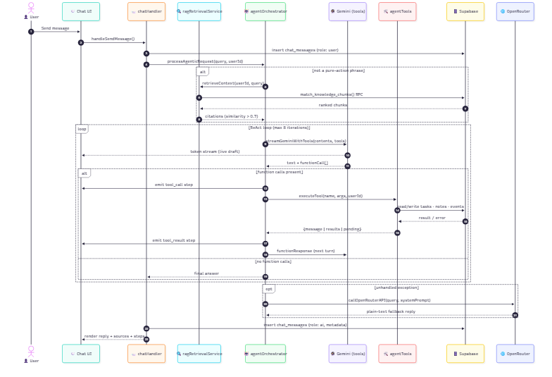

# AuraOne


**Sick of app overload?** AuraOne puts your tasks, notes, events, and news in one smart, AI-powered hub. **One app, zero chaos—just pure focus.**

An intelligent personal assistant designed for comprehensive task management, note-taking, event scheduling, and news aggregation.

## ✨ Features

### Core Features
- **User Authentication** - Secure Supabase authentication with email/password
- **Aura Assistant** - Streaming ReAct agent with tool calls over your own data, Command and Brain modes
- **Knowledge Base** - Personal RAG over your notes, tasks and events (Explorer and Playground views)
- **Note Management** - TipTap rich text editor with markdown and tags
- **Task Management** - Priority-based task tracking with due dates
- **Event Scheduling** - Interactive calendar with event management
- **News Aggregation** - Real-time news from multiple sources
- **Weather Integration** - Current weather and 5-day forecasts
- **Dark/Light Theme** - Seamless theme switching with system preference detection

### User Experience
- Responsive design optimized for desktop, tablet, and mobile
- Real-time updates with Supabase live synchronization
- "Living Map" visual design with Framer Motion page transitions
- Public landing page, login, sign up and password reset
- WCAG compliant with keyboard navigation

## 🚀 Quick Start

### Prerequisites
- Node.js 18+ and npm
- Supabase account (for authentication and database)
- API keys for Gemini (required); OpenRouter, OpenWeatherMap, NewsData.io (optional)

### Installation

```bash
# Clone the repository
git clone https://github.com/dhyan2815/AuraOne.git
cd AuraOne

# Install dependencies
npm install

# Set up environment variables
cp .env.example .env.local
# Edit .env.local with your API keys

# Start development server
npm run dev
```

### Environment Variables

Create a `.env.local` file with:

```env
VITE_SUPABASE_URL=your_supabase_url
VITE_SUPABASE_ANON_KEY=your_supabase_anon_key
VITE_GEMINI_API_KEY=your_gemini_api_key
VITE_OPENROUTER_API_KEY=your_openrouter_api_key   # fallback
VITE_WEATHER_API_KEY=your_openweathermap_api_key  # optional
VITE_NEWS_API_KEY=your_newsdata_api_key           # optional
```

The Knowledge Base needs the pgvector schema in `supabase/migrations/`.

## 🏗️ Architecture

### System Diagrams

**Activity Diagram** - User workflow and decision points:


**Data Flow Diagram** - System data movement:


**Entity Relationship Diagram** - Database schema:


**Sequence Diagram** - API interaction flow:


### Tech Stack
- **Frontend**: React 18.3.1, TypeScript 5.5.3, Vite 5.4.2
- **Styling**: Tailwind CSS 3.4.1, Framer Motion 11.0.8
- **Backend**: Supabase (Authentication, PostgreSQL, Realtime)
- **AI**: Google Gemini 2.5 Flash (primary, streaming), OpenRouter (fallback), `gemini-embedding-001` for RAG
- **APIs**: OpenWeatherMap, NewsData.io
- **UI Components**: Radix UI, Lucide React Icons, Sonner / react-hot-toast
- **Editor**: TipTap 3
- **Validation**: Zod 4, chrono-node (natural-language dates)

### AI Service Architecture
AuraOne features a robust, multi-model AI infrastructure that ensures high availability and intelligent workspace management:

- **ReAct loop**: `agentOrchestrator` streams Gemini function calls, executes tools, feeds results back until a final answer
- **Tools** (`agentTools.ts`, Zod-validated): `search_knowledge_base`, `list_items`, `create_task`, `update_task`, `create_note`, `update_note`, `schedule_event`, `update_event`, `get_agenda`, `find_free_slots`, `delete_item`
- **Step trace**: live thinking / tool call / tool result steps shown in chat
- **Delete confirmation**: `delete_item` only returns a pending action; the UI must confirm before anything is removed
- **RAG**: notes, tasks and events are chunked, embedded (768-dim) and retrieved with citations
- **Brain Mode**: deeper reasoning for complex planning
- **Fallback**: OpenRouter takes over transparently if Gemini fails or is rate limited

### Project Structure

```
src/
├── components/
│   ├── chat/                # ChatMessage, SessionSidebar, StepTrace
│   ├── editor/              # TipTap rich text editor
│   ├── structure/           # Layout, TopBar, AuthLayout, SiteFooter
│   ├── ui/                  # Card, Dialog, Loader, EmptyState, ...
│   └── widgets/             # Weather, Tasks, Calendar, News
├── pages/                   # Landing, auth, Dashboard, Notes, Tasks, Calendar, Chat, KnowledgeBase, Settings
├── hooks/                   # useAuth, useTasks, useNotes, useEvents
├── services/
│   ├── agentOrchestrator.ts # Streaming ReAct loop
│   ├── agentTools.ts        # Tool registry (CRUD + agenda)
│   ├── agentPrompts.ts
│   ├── llmService.ts        # Gemini streaming + OpenRouter fallback
│   ├── rag*Service.ts       # Chunking, embedding, ingestion, retrieval
│   ├── chatHandler.ts / chatSessionService.ts
│   └── supabase.ts
├── config/api.ts            # API configuration
└── utils/aiCommandSchema.ts # Zod schemas
```

## 🧪 Testing

```bash
# Run all tests (watch)
npm test

# Single run
npm run test:run

# Run tests with coverage
npm test -- --coverage
```

### Test Structure

```
tests/
├── unit/          # hooks and agentTools
├── integration/   # AI fallback
├── e2e/           # chat.spec.ts
└── 2026-05-11-ai-assistant-response-testing/
```

## 🎯 Features in Detail

### Dashboard
- Weather widget with 5-day forecast
- Task overview with priority indicators
- Calendar widget for upcoming events
- News widget with source attribution

### Aura Assistant
- **Command Mode**: Agent tool calls for full CRUD on tasks, notes and events
  - Create tasks: "Remind me to buy groceries tomorrow"
  - Read notes: "Show all my notes"
  - Update events: "Reschedule meeting to 3pm"
  - Delete items: "Remove the old task" (asks for confirmation first)
  - Plan: "What's on my agenda Friday?", "Find a free slot tomorrow"
- **Brain Mode**: Deep reasoning for complex queries
  - Multi-step analysis
  - Strategic planning
  - Creative tasks

### Notes Management
- TipTap rich text editor with markdown rendering
- Custom tagging system
- Full-text search and filtering
- Real-time sync across devices

### Task Management
- Three priority levels: High, Medium, Low
- Due date tracking with calendar integration
- Complete/pending status management
- AI-powered task recommendations

### Calendar & Events
- Interactive month view with event indicators
- Quick event creation with natural language
- Edit and delete functionality
- Today's schedule view

## 📁 Reports & Documentation

Test reports and documentation are stored in the `reports/` folder:

```
reports/
└── 2025-05-11-ai-assistant-response-testing/
    ├── test-evaluation-analysis.md
    ├── summary-report.md
    ├── brain-mode-report.md
    └── command-mode-report.md
```

## 🛠️ Development

```bash
# Start development server
npm run dev

# Build for production
npm run build

# Preview production build
npm run preview

# Run linter
npm run lint
```

## 📄 License

This project is private and proprietary. All rights reserved.

## 👨‍💻 Author

**Dhyan Patel**
- GitHub: [@dhyan2815](https://github.com/dhyan2815)
- LinkedIn: [Dhyan Patel](https://linkedin.com/in/dhyan-patel)
- Portfolio: [Dhyan Dev](https://dhyan-patel.onrender.com)

## 🙏 Acknowledgments

- [React](https://reactjs.org/) - Amazing UI framework
- [Supabase](https://supabase.com/) - Backend services
- [Tailwind CSS](https://tailwindcss.com/) - Utility-first CSS
- [Vite](https://vitejs.dev/) - Fast build tooling
- [Framer Motion](https://www.framer.com/motion/) - Animations
- [Radix UI](https://radix-ui.com/) - Accessible components
- [Zod](https://zod.dev/) - Schema validation
- [Gemini](https://ai.google.dev/) - AI capabilities
- [OpenRouter](https://openrouter.ai/) - AI fallback

---

<div align="center">
  <p><strong>Empower your productivity with AuraOne</strong><br>Created by <a href="https://github.com/dhyan2815">Dhyan Patel</a></p>
  <p>
    <a href="https://aura-one1.web.app/">🌐 Live Demo</a> •
    <a href="https://github.com/dhyan2815/AuraOne/issues">🐛 Report Bug</a> •
    <a href="https://github.com/dhyan2815/AuraOne/issues">💡 Request Feature</a>
  </p>
</div>