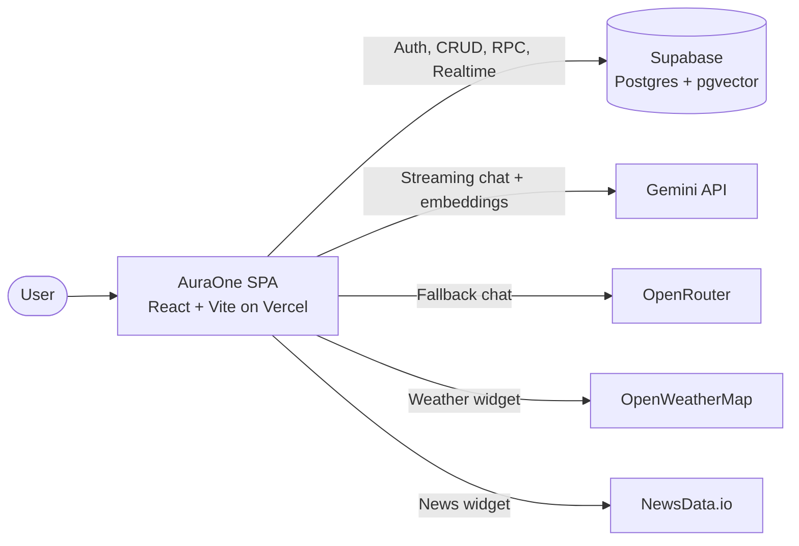

# AuraOne Architecture Documentation

Last Edited: 2026-11-01 21:09:59 IST (UTC+05:30)

## Overview

AuraOne is a single-page personal assistant built with React 18, TypeScript and Vite, backed by Supabase (Auth, Postgres, Realtime and pgvector). Users manage tasks, notes and events through regular pages and through **Aura**, a streaming ReAct agent. Aura runs on Gemini 2.5 Flash function calling and grounds its answers in a per-user RAG index. OpenRouter takes over if the Gemini loop fails.

There is no custom backend. The browser calls Supabase, Gemini, OpenRouter, OpenWeatherMap and NewsData.io directly, and Supabase Row Level Security (RLS) is the authorization boundary.



---

## Application Structure

### Routing (`src/App.tsx`)

`useAuth()` gates the route tree. A full-screen `Loader` renders while the Supabase session resolves.

| Access | Route | Page |
|--------|-------|------|
| Public | `/` | `LandingPage` (Framer Motion + Lenis smooth scroll) |
| Public | `/login`, `/signup`, `/forgot-password`, `/reset-password` | Auth pages, wrapped in `AuthLayout` |
| Public | `*` | Redirect to `/` |
| Authenticated | `/` | Redirect to `/dashboard` |
| Authenticated | `/dashboard` | `Dashboard` ("Today": weather, tasks, calendar, news widgets) |
| Authenticated | `/tasks`, `/tasks/:id` | `Tasks`, `TaskPage` |
| Authenticated | `/notes`, `/notes/:id` | `Notes`, `NotePage` (TipTap editor, 5 s idle autosave) |
| Authenticated | `/events` | `Calendar` |
| Authenticated | `/chat` | `Chat` (Aura) |
| Authenticated | `/knowledge` | `KnowledgeBase` (Explorer and Playground views) |
| Authenticated | `/settings` | `Settings` |

All pages are imported eagerly. The app has no route-level code splitting.

### Layout Shell (`src/components/structure/`)

- **`Layout.tsx`**: renders `TopBar`, owns the light/dark theme, animates route changes with Framer Motion (slide direction follows route depth), and plays a colour "flood" when the section changes. Motion is reduced when `prefers-reduced-motion` is set.
- **`sections.ts`**: the "Living Map" section registry. It maps each route to a colour class and nav label (Today, Tasks, Notes, Events, Aura, Knowledge, Settings).
- **`TopBar.tsx`**: navigation, theme toggle and a Radix dropdown user menu.
- **`AuthLayout.tsx`**, **`SiteFooter.tsx`**, **`Logo.tsx`**: auth page shell, public footer and brand mark.

### Layer Responsibilities

| Layer | Location | Responsibility |
|-------|----------|----------------|
| Pages | `src/pages/` | Route screens. Each owns its local state and data fetching. |
| Components | `src/components/` | `chat/` (ChatMessage, SessionSidebar, StepTrace), `editor/` (TiptapEditor), `widgets/`, `ui/` primitives |
| Data access | `src/hooks/` | The `useAuth` React hook, plus plain async CRUD modules for tasks, notes and events. These include realtime listeners and RAG ingestion side effects. |
| Services | `src/services/` | Agent, LLM clients, RAG pipeline, chat persistence, Supabase client |
| Config | `src/config/api.ts` | Endpoints, model names, RAG parameters, API key validation |

---

## Service Overview

| Service | File | Description |
|---------|------|-------------|
| **Agent Orchestrator** | `src/services/agentOrchestrator.ts` | Streaming ReAct loop (max 8 iterations), RAG pre-retrieval with a 60 s cache, citations, live step events, OpenRouter fallback |
| **Agent Tools** | `src/services/agentTools.ts` | 11 Zod-validated tools. The same table generates the Gemini function declarations. `performDelete` runs confirmed deletions. |
| **Agent Prompts** | `src/services/agentPrompts.ts` | `AGENT_SYSTEM_PROMPT` and `buildAugmentedPrompt`, which injects retrieved context with source labels |
| **LLM Service** | `src/services/llmService.ts` | `streamGeminiWithTools` (SSE), `callGeminiAPI` (non-streaming, currently unused) and `callOpenRouterAPI`, all with `AbortController` timeouts |
| **Chat Handler** | `src/services/chatHandler.ts` | Message lifecycle: save the user message, auto-title the session, run the agent, save the reply with metadata, write a classified error message on failure. Also resolves pending actions. |
| **Chat Sessions** | `src/services/chatSessionService.ts` | Session CRUD on `chat_sessions` |
| **RAG Chunking** | `src/services/ragChunkingService.ts` | Splits notes into paragraph chunks. Serializes each task or event into one chunk. |
| **RAG Embedding** | `src/services/ragEmbeddingService.ts` | `gemini-embedding-001` at 768 dimensions. Single and batched (100 texts per request). |
| **RAG Ingestion** | `src/services/ragIngestionService.ts` | Per-item re-indexing, fire-and-forget wrappers, full re-sync for a user |
| **RAG Retrieval** | `src/services/ragRetrievalService.ts` | Embeds the query, calls the `match_knowledge_chunks` RPC, returns `[]` on failure |
| **Supabase** | `src/services/supabase.ts` | Client singleton. Throws at startup if the URL or anon key is missing. |

---

## Aura Agent (ReAct)

### Request Lifecycle

```
Chat.tsx handleSend (optimistic user bubble, live step trace, streaming draft)
  └─ chatHandler.handleSendMessage
       1. INSERT user message → chat_messages
       2. Count session messages → if this is the first one, rename the session (≤ 40 chars)
       3. processAgenticRequest(query, userId, { isBrainMode, onEvent })
       4. INSERT AI message with metadata { sources, toolsUsed, steps, pendingActions }
       ✗ on error → INSERT "[SYSTEM ERROR @ <source>]" message
  └─ Refetch sessions + messages
```

### Orchestrator Loop (`processAgenticRequest`)

1. **Retrieval gate.** Imperative phrasing such as `add`, `create`, `schedule`, `delete`, `mark` or `reschedule` (the `PURE_ACTION` regex) skips RAG. Any other query calls `retrieveContext(userId, query, 5)` through an in-memory cache with a 60 s TTL.
2. **Citations.** Retrieved chunks with similarity > 0.7 become `SourceCitation`s.
3. **Prompt.** `buildAugmentedPrompt` puts a `RETRIEVED CONTEXT FROM KNOWLEDGE BASE` block (`[Source n: type (id)]`) before the user query. Brain mode appends a `[BRAIN MODE ENABLED]` directive to the system prompt and keeps the same model and tools. The empty-state suggestion chips switch Brain mode on.
4. **ReAct loop (at most 8 iterations).** `streamGeminiWithTools` streams one model turn, and text tokens reach the UI as they arrive.
   - **No function calls:** the streamed text is the final answer.
   - **Function calls:** text streamed in the same turn becomes a `thinking` step, and `reset_draft` clears the draft bubble. Each call then runs in order through `executeTool` and is recorded as a `tool_call` and a `tool_result` step. The results go back to the model as `functionResponse` parts for the next turn.
   - A successful mutating tool (`create_*`, `update_*`, `schedule_*`, `delete_*`) clears the RAG cache.
   - `search_knowledge_base` results are merged into the citations, deduplicated by id.
5. **Step limit.** After 8 iterations, Aura returns a fixed "reached the step limit" reply.
6. **Fallback.** Any exception in steps 1 to 5 sends the raw query to `callOpenRouterAPI`. The reply is plain text with no tools and no citations, and `toolsUsed` is `['fallback_openrouter']`.

> Each request starts a new Gemini conversation that contains only the current query and its retrieved context. Earlier messages in the session are stored and displayed but never sent to the model.

### Live Agent Events

| `AgentEvent` | Emitted when | Effect in `Chat.tsx` |
|--------------|--------------|----------------------|
| `token` | Each streamed text chunk, and the fallback text | Appended to the draft bubble |
| `reset_draft` | Text arrived together with tool calls | Draft cleared |
| `thinking` | Plan text is promoted to a step | Added to the live `StepTrace` |
| `tool_call` | Before each tool runs | Added to `StepTrace` |
| `tool_result` | After each tool runs | Added to `StepTrace` with ✓/✗ and a summary |

Steps are saved in the message metadata, so `ChatMessage` can still show the trace after a reload.

### Tool Registry (`agentTools.ts`)

| Tool | Purpose | Data touched |
|------|---------|--------------|
| `search_knowledge_base` | Semantic search with an optional source filter | `knowledge_chunks` (RPC) |
| `list_items` | List tasks, notes or events with a keyword filter (max 20, includes ids) | `tasks` / `notes` / `events` |
| `create_task` | Create a task (natural-language due date, priority defaults to medium) | `tasks` |
| `update_task` | Edit title, description, due date, priority or completion | `tasks` |
| `create_note` | Create a note with tags | `notes` |
| `update_note` | Edit title, content, tags or archive state | `notes` |
| `schedule_event` | Create a calendar event | `events` |
| `update_event` | Edit or reschedule an event | `events` |
| `get_agenda` | Events and incomplete tasks due in a date range, sorted by time | `events`, `tasks` |
| `find_free_slots` | Gaps between events (default ≥ 30 min, 09:00 to 18:00) | `events` |
| `delete_item` | Returns a `PendingAction`. Deletes nothing. | none |

- **One source of truth.** The `TOOLS` table holds each tool's name, description, Zod schema and `run` function. `AGENT_TOOLS` is generated from it with `z.toJSONSchema`, minus `$schema` and `additionalProperties` (Gemini rejects both).
- **Self-correction.** `executeTool` returns `{ error }` for an unknown tool, invalid arguments or a thrown error. The model reads the error, and the system prompt tells it to fix the arguments and retry once.
- **Dates.** Natural-language dates such as "tomorrow 3pm" are parsed with `chrono-node`.
- **Delete confirmation.** `delete_item` returns a pending action, which is saved in the message metadata. `ChatMessage` shows a confirm card. Confirming calls `performDelete()`, then `resolvePendingAction()` writes `confirmed` or `cancelled` back to the stored message.

### Fallback Chain

```
User prompt → processAgenticRequest
    ├─ RAG pre-retrieval (skipped for pure actions, 60 s cache)
    └─ ReAct loop: Gemini 2.5 Flash (SSE + function calling) ⇄ executeTool    [≤ 8 turns]
            │ any exception
            ▼
       OpenRouter (model "openrouter/free", plain text, no tools)
            │ exception
            ▼
       chatHandler writes "[SYSTEM ERROR @ Gemini Hub | Reasoning Matrix | Transmission Layer | Neural Core]"
```

The full flow diagram is in [`architecture/ai-fallback-chain.mmd`](../architecture/ai-fallback-chain.mmd) ([PNG](../architecture/ai-fallback-chain.png)).

### Timeouts and Retries

| Call | Timeout |
|------|---------|
| `callGeminiAPI` (`generateContent`) | 15 s |
| `streamGeminiWithTools` (`streamGenerateContent?alt=sse`) | 30 s per turn |
| `callOpenRouterAPI` | 45 s |
| Embedding calls | None |

Each timeout covers the wait for response headers. The abort timer is cleared once `fetch` resolves, so reading the body (including the SSE stream) has no time limit.

There is no retry loop. `SERVICE_CONFIG.MAX_RETRIES` and `BACKOFF_MS` are declared in `llmService.ts` but never used. Recovery comes from the OpenRouter fallback and from the model correcting its own tool errors.

---

## RAG Pipeline

### Ingestion (Write-Through)

Every create and update in `useTasks.ts`, `useNotes.ts` and `useEvents.ts` calls `silentIngest()`, and every delete calls `silentRemove()`. Both are fire-and-forget.

```
create / update → silentIngest(userId, type, id)
    → fetch record → chunk → DELETE old chunks (source_id) → embedBatch → UPSERT knowledge_chunks
delete → silentRemove(id) → DELETE chunks (source_id)
```

Ingestion errors are logged and swallowed, so a failed embedding never blocks the user's write. **Full re-sync:** the Sync action on the Knowledge page runs `ingestAllForUser()`, which re-indexes every note, task and event one at a time and reports progress as a percentage.

### Chunking

| Source | Strategy | Metadata |
|--------|----------|----------|
| Note | Prepend `Title: <title>`, split on blank lines, one chunk per paragraph | `title`, `tags`, `created_at` |
| Task | One chunk: title, description, priority, due date, status | `title`, `priority`, `due_date`, `completed` |
| Event | One chunk: title, start, end, description | `title`, `start_time`, `end_time` |

### Embedding and Retrieval

- **Model:** `gemini-embedding-001` with `outputDimensionality: 768`. `embedText` embeds queries, and `embedBatch` embeds ingestion chunks (100 texts per `batchEmbedContents` request).
- **Retrieval:** `retrieveContext(userId, query, topK)` embeds the query and calls the `match_knowledge_chunks` RPC.

| Parameter | Value |
|-----------|-------|
| Similarity | Cosine, `1 - (embedding <=> query_embedding)` |
| Match threshold | 0.5 (`getRAGConfig`) |
| Top K | 10 by default, 5 for orchestrator pre-retrieval |
| Citation cutoff | > 0.7 (orchestrator) |
| On error | Returns `[]`, and the agent continues without context |

### Vector Store (`supabase/migrations/20260516_knowledge_base.sql`)

- **Table:** `knowledge_chunks` with `id`, `user_id` (FK to `auth.users`, `ON DELETE CASCADE`), `source_type` (`note`/`task`/`event`), `source_id`, `chunk_index`, `content`, `embedding vector(768)`, `metadata jsonb`, `created_at`, `updated_at`.
- **Uniqueness:** `UNIQUE (source_id, chunk_index)`.
- **Indexes:** HNSW on `embedding` with `vector_cosine_ops` (`m = 16`, `ef_construction = 64`). B-tree on `user_id` and on `(source_type, source_id)`.
- **Security:** RLS is enabled, with SELECT, INSERT, UPDATE and DELETE policies that limit rows to `auth.uid() = user_id`. The RPC also filters on `filter_user_id`.

---

## Data Model

| Table | Key columns | Schema in repo |
|-------|-------------|----------------|
| `tasks` | `id`, `user_id`, `title`, `description`, `due_date`, `priority` (low/medium/high), `completed`, `created_at` | No |
| `notes` | `id`, `user_id`, `title`, `content`, `tags[]`, `is_archived`, `created_at` | No |
| `events` | `id`, `user_id`, `title`, `start_time`, `end_time`, `description`, `created_at` | No |
| `chat_sessions` | `id`, `user_id`, `name`, `created_at` | No |
| `chat_messages` | `id`, `session_id`, `user_id`, `role` (user/ai), `content`, `metadata` (sources, toolsUsed, steps, pendingActions), `created_at` | No |
| `knowledge_chunks` | See the Vector Store section above | Yes (migration) |

Only `knowledge_chunks` has a migration in this repo. The other five tables and their RLS policies are configured in the Supabase project and are not version-controlled here; the columns above come from the TypeScript interfaces. According to the comment on `deleteSession`, deleting a session cascades to its messages. See [`architecture/er_diagram.png`](../architecture/er_diagram.png).

---

## State Management

The app has no global store and no React Context. `zustand` is installed but never imported.

| State | Location | Notes |
|-------|----------|-------|
| Auth session | `useAuth()` hook | Every consumer gets its own instance, which calls `supabase.auth.getSession()` and subscribes to `onAuthStateChange`. Consumers include App, TopBar, the pages and the widgets. supabase-js keeps the session in localStorage. |
| Theme | `Layout` component state | Saved to `localStorage.theme`, falls back to `prefers-color-scheme`, and toggles the `dark` class on `<html>`. |
| Domain data | Page and widget `useState` | Loaded through the data-access modules on mount |
| Chat | `Chat.tsx` | Messages, sessions, live steps, streaming draft, Brain mode flag |

**Data-access modules.** Despite their names, `useTasks.ts`, `useNotes.ts` and `useEvents.ts` are not React hooks. They export plain async functions (`getX`, `createX`, `updateX`, `deleteX`, `listenToX`, plus `getXById` for tasks and notes) that pages, widgets and agent tools all share. Reads filter by `user_id`. Updates and deletes filter only by row id and depend on RLS.

### Realtime

| Screen | Subscription | Reaction |
|--------|--------------|----------|
| Notes | `listenToNotes`, all change types | Refetches the whole list |
| Calendar | `listenToEvents`, all change types | Refetches the whole list |
| Chat | `chat_messages` INSERT for the selected session | Merges the new row, deduplicated by id, and replaces the optimistic temp message |
| Tasks, Dashboard widgets, Knowledge | None | Refetches on mount and after its own mutations |

`listenToTasks` exists, but no screen uses it.

---

## Caching Strategy

### Active Caches

| Cache | Location | Key / TTL | Invalidation |
|-------|----------|-----------|--------------|
| RAG retrieval | `ragCache` Map in `agentOrchestrator.ts` | `${userId}\|${query}`, 60 s | Fully cleared after any successful mutating tool call. Expired entries are replaced on the next lookup but never evicted, so the Map is unbounded for the life of the tab. |
| Auth session | supabase-js (localStorage) | Token lifetime | Supabase auto-refresh |
| Theme | localStorage (`theme`) | Persistent | User toggle |
| Geolocation | Browser | `maximumAge: 60000` | Browser |

### Not Cached

- **Chat history** lives in Supabase (`chat_messages`) and is refetched after every send. The app does not keep a conversation context in memory for the model.
- **Weather and news** responses are fetched again each time the Dashboard mounts.
- **The `search_knowledge_base` tool** calls `retrieveContext` directly and skips the 60 s cache.
- **Data-access reads** always go to Supabase.

`tests/unit/caching.test.ts` tests a `SimpleCache` class defined inside the test file. It does not exercise application code.

### Future Caching Options

- TTL cache for weather and news responses (localStorage, 10 to 30 min)
- Send the `search_knowledge_base` tool through the same retrieval cache
- Bound the RAG cache in size (LRU)
- Move LLM and embedding calls to Supabase Edge Functions, which would also allow server-side caching

---

## Third-Party Integrations

| Service | Purpose | Endpoints / model |
|---------|---------|-------------------|
| **Google Gemini** | Agent reasoning, function calling, embeddings | `gemini-2.5-flash` via `streamGenerateContent?alt=sse` (and `generateContent`); `gemini-embedding-001` via `embedContent` and `batchEmbedContents` |
| **OpenRouter** | Fallback chat | `/api/v1/chat/completions`, model `openrouter/free` |
| **Supabase** | Auth, Postgres, Realtime, pgvector RPC | `@supabase/supabase-js` |
| **OpenWeatherMap** | Weather widget | `/data/2.5/weather` and `/data/2.5/forecast` (metric units, browser geolocation) |
| **NewsData.io** | News widget | `/api/1/news?country=in&language=en` (top 5 results) |
| **Google Fonts** | Bricolage Grotesque typeface | Loaded in `index.html` |

**Main frontend libraries:** React 18, React Router 6, Tailwind CSS 3 (with `@tailwindcss/typography` and `tailwindcss-animate`), Framer Motion 11, Lenis, TipTap 3 with `@tiptap/markdown`, react-markdown, Radix UI (Dialog, DropdownMenu), lucide-react, react-hot-toast, date-fns, chrono-node and Zod 4.

---

## Security Considerations

- **API keys reach the browser.** Every `VITE_*` variable is compiled into the client bundle, and the Gemini key is sent as a `?key=` query parameter. Anyone with the deployed JavaScript can extract the Gemini, OpenRouter, OpenWeatherMap and NewsData keys. Moving these calls behind Supabase Edge Functions would fix this. The Supabase anon key is meant to be public; RLS protects the data.
- **Tenant isolation.** RLS on `knowledge_chunks` is defined in this repo. The other tables rely on policies configured in the Supabase project.
- **Destructive actions.** The agent cannot delete anything until the user confirms it in the UI.
- **OpenRouter headers.** `HTTP-Referer` is hard-coded to `http://localhost:5173`, including in production.

---

## Deployment

- **Frontend:** Vercel static build (`tsc && vite build` → `dist/`). `vercel.json` rewrites every path to `/index.html` for client-side routing.
- **Backend:** Supabase (managed Postgres, Auth, Realtime). pgvector is enabled by the migration in `supabase/migrations/`.
- **CI:** `.github/workflows/preflights.yml` runs on every push and on PRs to `main` (Node 20): `npm ci` → `npx tsc --noEmit` → `npm run lint` → `npm run test:run -- --coverage` → `npm run build` → `npm audit --audit-level=moderate` (non-blocking).

### Required Environment Variables

```
VITE_SUPABASE_URL        # Required - the app throws at startup without it
VITE_SUPABASE_ANON_KEY   # Required - the app throws at startup without it
VITE_GEMINI_API_KEY      # Required - Aura agent and RAG embeddings
VITE_OPENROUTER_API_KEY  # Optional - fallback chat
VITE_WEATHER_API_KEY     # Optional - weather widget
VITE_NEWS_API_KEY        # Optional - news widget
```

---

## File Structure

```
├── .github/workflows/preflights.yml   # CI: typecheck, lint, tests, build, audit
├── architecture/                      # Diagrams (Mermaid source + PNGs)
├── docs/                              # ARCHITECTURE.md, PERFORMANCE.md, mobile transition report
├── plan/                              # Feature and implementation plans
├── reports/                           # Dated AI assistant test reports
├── supabase/migrations/               # 20260516_knowledge_base.sql (pgvector schema + RPC)
├── tests/                             # unit/, integration/, e2e/, dated AI response suite
└── src/
    ├── App.tsx                        # Route tree + auth gate
    ├── main.tsx                       # React root, BrowserRouter, Toaster
    ├── index.css                      # Tailwind layers + Living Map styles
    ├── components/
    │   ├── chat/                      # ChatMessage, SessionSidebar, StepTrace
    │   ├── editor/                    # TiptapEditor
    │   ├── structure/                 # Layout, TopBar, AuthLayout, SiteFooter, Logo, sections.ts
    │   ├── ui/                        # Card, ChunkCard, Count, Dialog, EmptyState, Loader
    │   └── widgets/                   # Weather, News, Tasks, Calendar
    ├── config/
    │   └── api.ts                     # Endpoints, models, RAG config, key validation
    ├── hooks/
    │   ├── useAuth.ts                 # Auth hook
    │   ├── useTasks.ts                # Task data access + realtime + RAG ingest
    │   ├── useNotes.ts                # Note data access + realtime + RAG ingest
    │   └── useEvents.ts               # Event data access + realtime + RAG ingest
    ├── pages/                         # Landing, Login, SignUp, ForgotPassword, ResetPassword,
    │                                  # Dashboard, Tasks, TaskPage, Notes, NotePage, Calendar,
    │                                  # Chat, KnowledgeBase, Settings
    ├── services/
    │   ├── agentOrchestrator.ts       # Streaming ReAct loop + RAG cache + fallback
    │   ├── agentTools.ts              # Tool registry + executeTool + performDelete
    │   ├── agentPrompts.ts            # System prompt + context augmentation
    │   ├── llmService.ts              # Gemini (SSE) + OpenRouter clients
    │   ├── chatHandler.ts             # Message lifecycle + pending actions
    │   ├── chatSessionService.ts      # Session CRUD
    │   ├── ragChunkingService.ts      # Chunking
    │   ├── ragEmbeddingService.ts     # Gemini embeddings
    │   ├── ragIngestionService.ts     # Indexing pipeline
    │   ├── ragRetrievalService.ts     # Similarity search
    │   └── supabase.ts                # Supabase client
    └── utils/
        └── aiCommandSchema.ts         # Legacy JSON-command schema (unused)
```

---

## Testing

| Suite | Location | Coverage |
|-------|----------|----------|
| Unit | `tests/unit/` | `useTasks`, `useNotes`, `useEvents` and `useAuth` against a mocked Supabase; `agentTools` (Gemini-safe schemas, argument validation, delete gate, free-slot calculation); a test-local cache |
| Integration | `tests/integration/ai-fallback.test.ts` | Response and retry patterns against a mocked `fetch`. Does not import `llmService`. |
| Scenario | `tests/2026-05-11-ai-assistant-response-testing/` | Brain mode and Command mode response scenarios against a mocked `fetch` |
| E2E | `tests/e2e/chat.spec.ts` | Playwright chat flow (`npm run test:e2e`). The repo has no Playwright config. |

At the time of this edit, `npm run test:run` passes 109 tests in 8 files and `npm run build` succeeds.

---

## Legacy and Unused Code

- **`src/utils/aiCommandSchema.ts`:** the JSON-command schema (create/read/update/delete/chat) from before the agent. Nothing imports it now; tool validation lives in `agentTools.ts`.
- **`callGeminiAPI`** (non-streaming) in `llmService.ts` has no callers.
- **`SERVICE_CONFIG.MAX_RETRIES` and `BACKOFF_MS`** are declared but never used.
- **`listenToTasks`** is defined but never subscribed.
- **Installed but never imported in `src/`:** `zustand`, `ai`, `@google/stitch-sdk`, `sonner`, `clsx`, `tailwind-merge`, `class-variance-authority`, and the Radix packages `avatar`, `popover`, `select`, `slider`, `slot`, `tabs`, `toast` and `tooltip`. Vite tree-shakes them out, so they add install size but not bundle size.

---

## Architecture Diagrams

| Diagram | File |
|---------|------|
| AI fallback chain (ReAct + RAG) | [`architecture/ai-fallback-chain.mmd`](../architecture/ai-fallback-chain.mmd), [PNG](../architecture/ai-fallback-chain.png) |
| Activity diagram | [`architecture/activity_diagram.png`](../architecture/activity_diagram.png) |
| Data flow diagram | [`architecture/dfd_diagram.png`](../architecture/dfd_diagram.png) |
| Entity relationship diagram | [`architecture/er_diagram.png`](../architecture/er_diagram.png) |
| Sequence diagram | [`architecture/sequence_diagram.png`](../architecture/sequence_diagram.png) |
