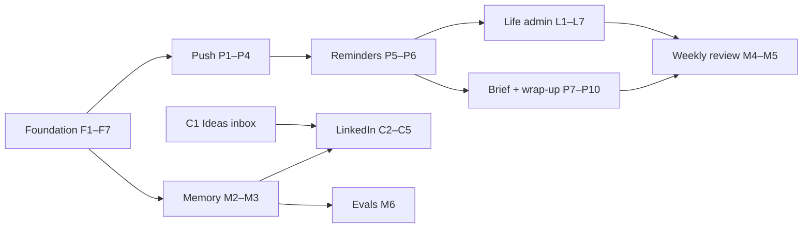

# AuraOne Roadmap

**Owner:** Dhyan Patel · **Written:** 1 Nov 2026 · **Pace:** 1–2 hrs/week (one session ≈ one week)

## Why this plan

Today AuraOne only does something when you open it. It has no service worker, no notifications and no scheduled jobs, and a task's due date never triggers anything. Aura also runs in the browser, so the Gemini and OpenRouter keys ship inside the public JavaScript bundle.

This plan changes three things:

1. **AuraOne reaches out to you.** Reminders, a morning brief and an evening wrap-up arrive as notifications with buttons.
2. **It runs the parts of your day you repeat.** Bills, habits, shopping lists and LinkedIn posts.
3. **Aura remembers you.** It keeps the conversation, your preferences and your writing voice, and sends a weekly review of your week.

Every step also teaches something you haven't built yet (see [What you'll learn](#what-youll-learn)).

**Decisions from our Q&A**

| Topic | Decision |
|---|---|
| Feature tracks | Proactive Aura, Aura memory + insights |
| Daily use to cover | LinkedIn content, personal life admin |
| LinkedIn scope | Ideas + drafts. You post by hand; no LinkedIn API |
| Life admin scope | Recurring tasks, habits + streaks, errands/lists |
| Phone | Android (Web Push works in Chrome; installing the app is optional) |
| Pace | 1–2 hrs per week, so every step is a ~1-hour session |
| Cost | Stay on free tiers (Supabase Free, Gemini free tier, Vercel Hobby) |

---

## At a glance

34 sessions. At one session a week that's about 8 months. Each milestone ends with something you'll actually use.

| # | Milestone | Sessions | Weeks | Target | What you get |
|---|---|---|---|---|---|
| 0 | Stopgap | — | now | 15 min | Exposed keys are harder to abuse |
| 1 | Aura on the server | C1, F1–F7 | 1–8 | Dec 2026 | Keys hidden, Aura remembers the conversation, ideas inbox |
| 2 | Aura can reach you | P1–P6 | 9–14 | Feb 2027 | Notifications; due reminders with Done / Snooze |
| 3 | Daily rhythm | P7–P10 | 15–18 | Mar 2027 | Morning brief, evening wrap-up |
| 4 | Life admin | L1–L7 | 19–25 | Apr 2027 | Recurring bills, habits + streaks, lists |
| 5 | Aura knows you | M2–M3, C2–C5 | 26–31 | Jun 2027 | Long-term memory, LinkedIn drafts in your voice |
| 6 | Insights | M4–M6 | 32–34 | late Jun 2027 | Weekly review, Aura evals |



After milestone 2, milestones 3, 4 and 5 barely depend on each other, so reorder them if one excites you more. The few cross-links (for example, habits showing up in the brief) are called out in each step.

## What you'll learn

| Concept | Sessions |
|---|---|
| Serverless functions (Supabase Edge Functions, Deno), JWT auth, server secrets | F1–F4 |
| Streaming over Server-Sent Events (SSE) | F4 |
| Event-driven work with database webhooks | F6 |
| CI for a second runtime (Deno) | F7 |
| Schema as code (`supabase db pull`, migrations) | F1 |
| Service workers, installable PWA, Web Push (VAPID) | P1–P3 |
| Signed one-time tokens (HMAC) | P4 |
| Scheduled jobs: `pg_cron`, `pg_net`, Supabase Vault, idempotent jobs | P5, P9 |
| Time zones done right | P2, P9, L3 |
| Headless agents with guardrails, budgets and run logs | P8 |
| PL/pgSQL triggers and date arithmetic | P5, L1 |
| SQL window functions (gaps-and-islands for streaks) | L3 |
| LLM structured output (JSON schema) | L7, M3 |
| Agent memory design (write policy, recall, user control) | F5, M2–M3 |
| Grounded LLM reports (SQL computes, LLM only writes) | M4–M5 |
| LLM evals (golden sets, dry runs, pass rates) | M6 |
| Style extraction and few-shot prompting | C2, C4 |

## How to work at 1–2 hrs/week

- **One session = one checkbox.** Read the step's *Done when* first, stop once it's true, then commit and push.
- **If a session runs over, split it.** Don't leave half-done work on `main`; use a branch per session.
- **Live with each milestone for a week** before starting the next. Real use tells you what to fix.
- **Tick the boxes in this file** as you go.
- **New screens follow the Living Map design** (`docs/living-map/`). To keep the nav small, Habits and Lists go in as tabs on Tasks, and Posts as a tab on Notes.

---

## 0 · Stopgap (15 min, do it now)

`src/config/api.ts` reads `VITE_GEMINI_API_KEY` and `VITE_OPENROUTER_API_KEY`, so both keys are in the deployed bundle. F7 removes them. Until then:

- [ ] Google Cloud Console → *Credentials* → your Gemini key → *Application restrictions: HTTP referrers* → your Vercel domain and `localhost`. This blocks casual reuse from other sites. Scripts can fake the referrer, so it isn't a fix.
- [ ] OpenRouter → *Keys* → set a credit limit on the key.

---

## 1 · Foundation: Aura on the server (F1–F7)

**Why first:** Reminders, briefs and the weekly review need code that runs while your browser is closed. Moving Aura to the server also gets the keys out of the browser.

**You get:** The same Aura, with the keys out of the browser, and it remembers what you said a minute ago.

**Flow after this milestone**

```
Chat page ──fetch + your login token──▶ aura-chat (Edge Function)
                                        ├─ loads the last 10 messages of the chat (memory)
                                        ├─ RAG: embed question → match_knowledge_chunks
                                        ├─ ReAct loop: Gemini ⇄ tools (Supabase client acting as you, RLS on)
                                        └─ streams steps + answer tokens back (SSE)

notes / tasks / events change ──database webhook──▶ aura-index ──▶ knowledge_chunks
```

**Steps**

- **Week 1: do C1 first.** The ideas inbox lives in the LinkedIn track ([§5](#5--linkedin-ideas--drafts-c1c5)), but it's small and gets you capturing ideas in AuraOne from day one. Tick it off there.
- [ ] **F1 · First edge function.** Install the Supabase CLI, run `supabase init` and `supabase link`, then `supabase db pull` (needs Docker) so the existing tables (`tasks`, `notes`, `events`, `chat_*`) live in `supabase/migrations/`. Create a `hello` function that reads the caller from their JWT and returns their email; call it from the app.
  *Done when:* the browser console prints your email from the function, and a `curl` without a token gets `401`.
- [ ] **F2 · Make the agent portable.** Tools currently reach the browser Supabase client through the hooks (`src/services/agentTools.ts` → `src/hooks/use*.ts`). Change every tool from `run(args, userId)` to `run(args, ctx)`, where `ctx = { db, userId, timeZone }`. Then move `agentTools`, `agentOrchestrator`, `agentPrompts`, `llmService` and RAG retrieval into `supabase/functions/_shared/agent/`.
  *Done when:* `npm run test:run` passes against the new paths, and nothing in `_shared/agent` imports from `src/`.
- [ ] **F3 · `aura-chat`, non-streaming.** The function takes `{ sessionId, message, brainMode }`. It builds `ctx` with a Supabase client created from the request's `Authorization` header (so RLS still applies), runs the loop and returns the `AgentResponse` as JSON. Run `supabase secrets set GEMINI_API_KEY=… OPENROUTER_API_KEY=…`. The Chat page calls it behind a `VITE_SERVER_AGENT=true` flag.
  *Done when:* "add a task to call mom tomorrow" works with the flag on, and the network tab shows no request to `generativelanguage.googleapis.com`.
- [ ] **F4 · Stream it.** Respond with `text/event-stream`, one `data:` line per `AgentEvent`. The Chat page reads it with plain `fetch` and `response.body.getReader()`. Delete-confirmation cards must still work. Remove the flag.
  *Done when:* tokens and the step trace appear live, the same as today.
- [ ] **F5 · Conversation memory (memory track, M1).** The server loads the last 10 messages of the session from `chat_messages` and sends them as Gemini `user` / `model` turns before the new message.
  *Done when:* "what's my top task?" followed by "mark it done" completes the right task.
- [ ] **F6 · Index on the server.** Add an `aura-index` function that receives the webhook payload `{ type, record, old_record }` and re-chunks and embeds the item, or deletes its chunks. Add database webhooks on `notes`, `tasks` and `events`. The Knowledge Base *Rebuild* button calls `aura-index` for your user. Remove `silentIngest` / `silentRemove` from the hooks.
  *Done when:* a note created in the Supabase table editor (not the app) shows up in the Knowledge Base Explorer.
- [ ] **F7 · Lock it down.** Remove `VITE_GEMINI_API_KEY` and `VITE_OPENROUTER_API_KEY` from the code, `.env` and Vercel. Rotate both keys, because old deployments still contain them. Add a `deno check` step for `supabase/functions` to `.github/workflows/preflights.yml`, and update `README.md` and `docs/ARCHITECTURE.md`.
  *Done when:* `npm run build && grep -rE "AIza|sk-or-" dist/` finds nothing and CI is green.

**Gotchas**

- **Time zones.** The server runs in UTC, so `chrono.parseDate("tomorrow 3pm")` there means 3 pm UTC, which is 8:30 pm IST. Pass `ctx.timeZone` as chrono's reference. Until P2 stores it, the browser sends it from `Intl.DateTimeFormat().resolvedOptions().timeZone`.
- **Keep Vitest working.** Keep `_shared/agent` free of `Deno.*` globals and use bare imports (`zod`, `chrono-node`) mapped in an import map (`deno.json`). Node and Vitest can then still import and test the same files.
- **Two auth modes.** `aura-chat` acts as the user (their JWT, RLS on). `aura-index` is called by the database, so it uses the service role and must filter by `record.user_id` itself. Protect it with a shared-secret header.
- **Time limit.** Edge functions have a wall-clock limit (150 s on the free plan when this was written). The loop fits, but keep `MAX_ITERATIONS`.

---

## 2 · Proactive Aura (P1–P10)

This is the part that brings you back every day.

### 2a · Push notifications (P1–P4)

**You get:** AuraOne installed on your Android home screen, and notifications with buttons.

**Flow**

```
Settings "Enable notifications" → Chrome asks permission → subscription saved in push_subscriptions
Any server job → _shared/push.ts → push service → service worker → notification on your phone
Tap "Done" → service worker POSTs a signed token → notification-action → task completed
```

**Steps**

- [ ] **P1 · Installable app.** Add `vite-plugin-pwa` with the `injectManifest` strategy (you need your own `src/sw.ts` for push handlers). Fix `public/site.webmanifest`: `start_url`, `theme_color`, `background_color`.
  *Done when:* Chrome on Android offers *Install app* and it opens without the browser bar.
- [ ] **P2 · Subscriptions + settings.** Generate VAPID keys: the public key goes in the app env, the private key in Supabase secrets. Create two tables, both with RLS:
  - `push_subscriptions(id, user_id, endpoint unique, p256dh, auth, created_at)`
  - `user_settings(user_id pk, time_zone, brief_time '08:00', wrap_time '21:00', quiet_start '22:30', quiet_end '07:30')`

  Add a *Notifications* section in Settings.
  *Done when:* turning notifications on writes a subscription row, and turning them off deletes it.
- [ ] **P3 · Send a push.** Write a `_shared/push.ts` helper and a `test-push` function behind a *Send test notification* button. Use a Web-Crypto-based library (for example `@negrel/webpush` from JSR), and try it on day one. Delete subscriptions that come back `404` / `410` (expired).
  *Done when:* the button buzzes your phone while the app is closed.
- [ ] **P4 · Buttons on notifications.** The payload carries `actions` (Android Chrome shows at most 2) and a signed token, `HMAC(secret, userId|itemId|action|expiresAt)`. In `sw.ts`, `notificationclick` with no action opens the deep link. With an action, it POSTs the token to `notification-action`; that function skips the JWT check and verifies the token instead.
  *Done when:* the *Done* button on a test notification completes a real task without opening the app.

**Gotchas**

- **Why a token:** a service worker can't read the Supabase session, because the session lives in `localStorage` and service workers can't access it.
- **Check the files are served.** `vercel.json` rewrites every path to `index.html`. After deploying, open `/sw.js` and the manifest URL directly to confirm they come back as files.
- **Timing isn't exact.** Android battery saving can delay pushes by a few minutes. That's fine for reminders.

### 2b · Due reminders (P5–P6)

**You get:** "Pay electricity bill, due in 1 hr" with **[Done] [Snooze 1h]** buttons.

**Flow**

```
pg_cron (every 5 min) → net.http_post → reminder-tick
  → tasks: not completed, reminded_at is null, remind_at <= now()
  → skip if inside quiet hours
  → push → set reminded_at = now()
Snooze → remind_at = now() + 1 h, reminded_at = null
```

**Steps**

- [ ] **P5 · Reminder job.** Add `remind_before interval default '1 hour'`, `remind_at` and `reminded_at` to `tasks`, plus a trigger that recomputes `remind_at` whenever `due_date` or `remind_before` changes. Store the function URL and a cron secret in Vault, then `cron.schedule('reminder-tick', '*/5 * * * *', …)`. `reminder-tick` sends the reminder and marks the task as reminded.
  *Done when:* a task due in 20 minutes pings your phone exactly once.
- [ ] **P6 · Snooze + Aura.** Wire the Snooze button. Add a `remindBefore` argument to the `create_task` / `update_task` tools, so "remind me 2 days before" works.
  *Done when:* Snooze pings again an hour later, and Aura can set "remind me a day before".

**Gotchas**

- **Date-only tasks.** The task page saves a task without a time as local midnight (`src/pages/TaskPage.tsx`). Treat local midnight as "date only" and remind at `brief_time` on the due day, not at 11 pm the night before.
- **Run it twice.** Run the tick twice in a row by hand and expect only one push. Debug with `cron.job_run_details`.
- **Paused projects.** Supabase pauses free projects after about a week of inactivity, and a paused project runs no cron. Daily use keeps it awake.

### 2c · Morning brief (P7–P9)

**You get at 08:00:** "3 tasks today, 1 overdue. Standup at 10:30. 31°C. Plan: …". Tapping it opens a brief card on the Today page.

**Flow**

```
pg_cron (every 15 min) → daily-brief
  → users whose local time passed brief_time and who have no brief for today
  → gather facts: events today, tasks due / overdue, weather (+ habits, lists, post day later)
  → headless Aura (read-only tools, 1–3 Gemini calls) writes a 3-line plan
  → insert into briefs → push → Today page shows the card
```

**Steps**

- [ ] **P7 · Brief v1, no LLM.** Create `briefs(id, user_id, for_date, data jsonb, text, created_at, unique(user_id, for_date))`. `daily-brief` gathers the facts and fills a sentence template. Run it by hand. The Today page (`src/pages/Dashboard.tsx`) shows the latest brief card.
  *Done when:* running the function by hand produces a card and a push.
- [ ] **P8 · Brief v2: Aura writes it.** Run the agent with read-only tools only (`get_agenda`, `list_items`, `search_knowledge_base`), `MAX_ITERATIONS = 3` and a token cap. Log every run to `agent_runs(user_id, kind, tokens_in, tokens_out, ms, ok, error)`.
  *Done when:* the brief reads like a plan, and an `agent_runs` row exists for it.
- [ ] **P9 · Put it on a schedule.** Run the cron every 15 minutes. The SQL picks users where `now() at time zone time_zone` has passed `brief_time` today and no brief row exists yet.
  *Done when:* the brief arrives at 08:00 IST two days in a row without you touching anything.

**Gotchas**

- **No one is watching.** A headless agent has nobody to confirm its actions, so never give it update or delete tools.
- **Always deliver something.** If Gemini fails, send the v1 template brief.
- **Bonus:** weather is now fetched on the server, so move `VITE_WEATHER_API_KEY` into Supabase secrets too.

### 2d · Evening wrap-up (P10)

**You get at 21:00:** "Done 4 of 6. Left: …" with **[Move to tomorrow] [Open]** buttons.

**Flow:** cron → `daily-wrap` → counts what you completed and what's still open today → push with one action → `notification-action` moves the open tasks to tomorrow at the same time.

- [ ] **P10 · Wrap-up.**
  *Done when:* *Move to tomorrow* moves the right tasks, and the next morning's brief lists them.
- [ ] *(Optional stretch)* Save each day as a short *Daily log* note. This feeds memory and the weekly review.

---

## 3 · Life admin (L1–L7)

### 3a · Recurring tasks (L1–L2)

**You get:** "Pay rent, every month on the 1st, remind me 2 days before." When you complete it, next month's task appears.

**Flow**

```
task marked complete (from the UI, Aura, or a notification) → AFTER UPDATE trigger
  → if repeat is set: insert the next task (series start + n × interval, first date in the future)
  → webhook indexes it (F6) → reminder fires before it (P5)
```

The logic lives in a database trigger, so all three ways of completing a task behave the same.

**Steps**

- [ ] **L1 · Schema + trigger.** Add `repeat` (`daily | weekly | monthly | yearly`), `repeat_every int default 1` and `series_id uuid` to `tasks`, with `unique(series_id, due_date)`. Write the trigger function `spawn_next_occurrence()`. Add `supabase/tests/recurring.sql` covering three cases: monthly on the 31st, completing a task 3 months late (the next due date must be in the future), and un-completing then re-completing (no duplicate, thanks to `on conflict do nothing`).
  *Done when:* all three cases pass.
- [ ] **L2 · UI + Aura.** Add a repeat picker on the task page, a "↻ monthly" badge in lists, and `repeat` arguments on `create_task` / `update_task`.
  *Done when:* "pay rent on the 1st every month, remind me 2 days before" creates the right task through Aura.

**Gotcha:** `'2027-01-31' + interval '1 month'` gives Feb 28. If you then add a month to Feb 28, the series stays on the 28th forever. Always compute from the series start (`start + n × interval`), not from the previous occurrence.

### 3b · Habits + streaks (L3–L5)

**You get:** a Today widget showing "Gym 🔥 12" and "Read 20 min 🔥 4" that you tap to check in. In the evening: "Did you go to the gym?" **[Yes]**

**Flow**

```
habits (what you track) + habit_checkins (one row per habit per day)
check in from Today, from Aura ("I went to the gym"), or from a notification
  → insert … on conflict do nothing
habit_streaks view: gaps-and-islands over check-in days → current + best streak
brief (P8) warns about streaks at risk · wrap-up (P10) asks about unchecked habits
```

**Steps**

- [ ] **L3 · Schema + streak SQL.** Create `habits(id, user_id, name, emoji, archived)` and `habit_checkins(habit_id, user_id, day date, unique(habit_id, day))` with RLS, plus a `habit_streaks` view for current and best streak. Version 1 supports daily habits only.
  *Done when:* the view returns correct streaks for seeded data that contains a gap.
- [ ] **L4 · Habits UI.** Add a habits widget on Today (tap to check in, tap again to undo) and a Habits tab on Tasks.
  *Done when:* you check in from your phone for a week.
- [ ] **L5 · Nudges + Aura.** The wrap-up asks about unchecked habits with a **[Yes]** button. Add `log_habit` and `habit_stats` tools.
  *Done when:* "how's my gym streak?" gets the real number.

**Gotcha:** `day` must be your local date: `(now() at time zone time_zone)::date`. A 1 am IST check-in is still the previous day in UTC.

### 3c · Errands & lists (L6–L7)

**You get:** say "add milk, eggs and a phone charger" and they land on Groceries (milk, eggs) and Errands (charger). On Saturday at 10:00: "6 things on Groceries."

**Flow**

```
Aura add_to_list(items[]) → Gemini structured output picks list + category → list_items rows
Lists tab: grouped by category, tap to check off
per-list reminder (e.g. Groceries · Sat 10:00) → reminder-tick sends it only if items are open
```

**Steps**

- [ ] **L6 · Lists.** Create `list_items(id, user_id, list, text, category, done, created_at)`, a Lists tab on Tasks, and `add_to_list`, `check_off` and `show_list` tools.
  *Done when:* one sentence adds 3 items to the right lists.
- [ ] **L7 · Smarter lists.** Auto-categorize items with Gemini `responseSchema` (JSON output). Add `list_reminders(user_id, list, weekday, time)` and handle them in `reminder-tick`. The brief mentions open lists.
  *Done when:* the Saturday reminder arrives only when Groceries has open items.

**Not doing:** "Remind me when I'm near the store." A web app can't watch your location in the background.

---

## 4 · Aura memory + insights (M1–M6)

M1 (conversation memory) is done in the foundation as **F5**.

### 4a · Long-term memory (M2–M3)

**You get:** Aura remembers things like "I go to the gym at 7 am", "keep my posts under 150 words" and "my landlord is Mr. Shah". Settings shows everything it remembers, and you can edit or delete any of it.

**Flow**

```
write:   explicit ("remember that …") → remember tool
         implicit → after each reply, a small extraction call proposes facts
                  → dedupe (similarity > 0.9 means update, not insert) → saved with the source message
recall:  every aura-chat call → pinned memories (preferences, voice) + top 5 by similarity → system prompt
control: Settings → "What Aura remembers" · chat shows a "Remembered: …" chip with Undo
```

**Steps**

- [ ] **M2 · Memory store.** Create `aura_memories(id, user_id, kind ('preference'|'fact'|'voice'), content, embedding vector(768), pinned, source_message_id, created_at, last_used_at)` with RLS and a `match_memories()` RPC. Add `remember` and `forget` tools, inject memories into the prompt, and add a Settings list.
  *Done when:* a preference you state in one chat is used in a brand-new chat.
- [ ] **M3 · Auto-remember.** After each reply, run an extraction call with structured output: `{ memories: [{ kind, content }] }`, at most 3 per reply, usually none. Dedupe, then show the chip with Undo.
  *Done when:* a casual "I hate morning meetings" is remembered without you asking, and Undo removes it.

**Gotchas**

- **No secrets.** Never store passwords, OTPs or card numbers: add a rule to the extraction prompt and a regex filter.
- **Keep prompts small.** Cap injected memories at about 15 lines, and use `last_used_at` to find stale ones.

### 4b · Weekly review (M4–M5)

**You get:** a Sunday 19:00 push, "Your week". It links to a note covering what you finished, habit %, posts published, your busiest day, and 3 suggestions for next week.

**Flow**

```
pg_cron (Sunday) → weekly-review → weekly_stats(user, week) RPC → numbers as JSON
  → Gemini writes the review using only those numbers
  → check: every number in the text exists in the JSON
  → save as a note (tag weekly-review) → push
```

**Steps**

- [ ] **M4 · Stats in SQL.** A `weekly_stats()` RPC returns tasks done and created, completion by weekday, overdue count, habit check-in % per habit, posts published and notes written.
  *Done when:* the output matches a manual count for last week.
- [ ] **M5 · The review.** Add the `weekly-review` function, a Sunday cron and the number check. If the check fails, regenerate once; if it fails again, send the plain numbers.
  *Done when:* two Sundays in a row produce a review note with correct numbers.

### 4c · Aura evals (M6)

**You get:** one command that tells you whether a prompt or model change made Aura worse.

**Flow**

```
evals/cases.json (prompt → expected tool + key args)
  → npm run eval → agent in dry-run mode (changes are recorded, not executed)
  → pass/fail table → reports/evals/<date>.md
```

- [ ] **M6 · Eval harness.** Write about 25 cases covering tasks, recurring tasks, habits, lists, memory and posts. Build a dry-run `ctx`, a runner script and the first report.
  *Done when:* `npm run eval` prints a pass rate and saves a report. Run it before every prompt or model change. Keep it out of CI, because it costs API calls and results vary between runs.

---

## 5 · LinkedIn: ideas → drafts (C1–C5)

**You get:** You capture ideas in seconds, and Aura drafts posts in your voice from your own notes. On your posting days, the morning brief tells you what's ready. You still post by hand.

**Flow**

```
idea (note tagged post-idea)
  → draft_post: idea + related notes (RAG) + voice memory → posts row (draft)
  → you edit → ready → [Copy] + [Open LinkedIn] → mark posted (+ URL)
posting days (Settings) → morning brief: "Post day: 2 drafts ready"
weekly review counts posts
```

**Steps**

- [ ] **C1 · Ideas inbox (week 1 warm-up).** Add an Aura prompt rule: a message starting with `idea:` creates a note tagged `post-idea`. Add an *Ideas* filter chip on Notes. No migration needed, because notes already have `tags`.
  *Done when:* "idea: what interns learn from code review" shows up under Notes → Ideas.
- [ ] **C2 · Voice profile** (needs M2). Paste 5–10 of your past posts. Aura extracts a style guide (hooks, length, line breaks, emoji use, sign-off) and saves it as a pinned `voice` memory you can edit.
  *Done when:* Settings shows your style guide.
- [ ] **C3 · Posts pipeline.** Create `posts(id, user_id, idea_note_id, draft, status ('draft'|'ready'|'posted'), post_on, posted_at, url)` and a Posts tab on Notes, grouped by status.
  *Done when:* you can move a post through every status.
- [ ] **C4 · Draft with Aura.** Add a `draft_post` tool and a *Draft with Aura* button on an idea. It uses the idea, the top related notes and your voice. The draft shows which notes it used, through the existing source citations. Add a copy button and an *Open LinkedIn* link.
  *Done when:* you publish one real post that started in AuraOne.
- [ ] **C5 · Posting rhythm.** Add `posting_days` to `user_settings`. On those days the brief lists ready drafts with an **[Open]** button, or nudges you to draft one if none are ready.
  *Done when:* a Tuesday brief tells you which draft to post.

---

## Reference

### New tables and columns

| Session | Change |
|---|---|
| F1 | Existing schema pulled into `supabase/migrations/` |
| P2 | `push_subscriptions`, `user_settings` |
| P5 | `tasks`: `remind_before`, `remind_at`, `reminded_at` |
| P7–P8 | `briefs`, `agent_runs` |
| L1 | `tasks`: `repeat`, `repeat_every`, `series_id` |
| L3 | `habits`, `habit_checkins`, `habit_streaks` view |
| L6–L7 | `list_items`, `list_reminders` |
| M2 | `aura_memories`, `match_memories()` |
| M4 | `weekly_stats()` |
| C3, C5 | `posts`, `user_settings.posting_days` |

Every new table gets RLS with `user_id = auth.uid()` policies and a migration file in `supabase/migrations/`, never a dashboard-only change.

### Edge functions and how each one is protected

| Function | Called by | Auth |
|---|---|---|
| `aura-chat` | Chat page | Your JWT (RLS applies) |
| `aura-index` | Database webhook, KB *Rebuild* | Shared secret / your JWT |
| `test-push` | Settings button | Your JWT |
| `notification-action` | Service worker | Signed HMAC token |
| `reminder-tick` | `pg_cron` every 5 min | Cron secret from Vault |
| `daily-brief`, `daily-wrap` | `pg_cron` every 15 min | Cron secret from Vault |
| `weekly-review` | `pg_cron` on Sunday | Cron secret from Vault |

### Free-tier check

| Service | Expected use | Fits? |
|---|---|---|
| Supabase Edge Functions (500K invocations/month on Free) | Cron alone ≈ 15K/month, plus chat | Yes |
| Gemini free tier | Brief + wrap-up + weekly review ≈ 3–6 calls/day, plus chat | Yes for one user; check current limits in AI Studio |
| Web Push | Free | Yes |
| Vercel Hobby | Unchanged | Yes |

### Not in this plan (and why)

- **Quick capture** (share sheet, voice notes, Telegram bot): not picked this round. It's a good next plan after milestone 3.
- **Google Calendar sync, MCP server:** not picked. Once F1–F7 put the tools on the server, an MCP server becomes a small project.
- **Native app (Expo):** a PWA with Web Push covers Android for now.
- **LinkedIn auto-publish:** you chose ideas + drafts.
- **Appointments:** events cover the basics. Event reminders are a small add-on to P5 if you want them.
- **Location-based reminders:** a web app can't watch your location in the background.
